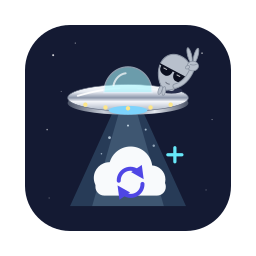

# Cloud Transfer+

A free, open-source Mac app that copies a MEGA cloud library into iCloud Drive, file by file, through your own Mac.
No third-party server sees your files or your passwords.



New here? Read the **[user guide](GUIDE.md)**.

## What it does

- **Pick a MEGA folder and an iCloud Drive folder, then press Start.** The app lists everything, then copies it over.
- **Runs unattended.** Several files at a time (more while you're away from the Mac), keeps the Mac awake while copying,
  and picks up exactly where it stopped after a quit, crash or power cut.
- **Turbo.** One toggle (⇧⌘T) for when you step away: 10 files at a time and faster retries, still with a free-space
  check before every file.
- **Fixes its own hiccups.** A file that fails is retried quietly a few seconds later. Nothing stops the whole run.
- **Doesn't fill your disk.** It checks free space before every file and, once Apple confirms a file is uploaded,
  frees the local copy (iCloud keeps it online).
- **Shows real progress.** Overall, per batch and per file, for both the MEGA download and the iCloud upload, with a
  realistic time-left estimate. Optional sounds and spoken progress every 10%, built with low-vision users in mind.
- **Skips junk.** Windows Recycle Bin and system folders can be excluded in one click.
- **Never touches your MEGA originals.** It only reads from MEGA.

## Requirements

- macOS 14 or later.
- [MEGAcmd](https://mega.io/cmd), MEGA's free helper app, installed and signed in through its own window.
  Cloud Transfer+ is a companion to it: on first launch it asks whether you have it and walks you through installing it.
  Cloud Transfer+ never asks for your MEGA password or 2FA code.
- iCloud Drive turned on, with enough iCloud storage for what you're copying.

## Build

```sh
swift run SafetyChecks      # path and safety checks
swift run EngineChecks      # transfer-engine checks against a fake MEGA, no network
./scripts/build.sh          # builds "Cloud Transfer+.app" in .build/bundle
```

The build is signed ad hoc for your own Mac. To share a build with others, sign and notarize it with your own
Apple Developer ID.

## Privacy

Everything stays on your Mac. The app keeps its run history in `~/Library/Application Support/Cloud Transfer+`.
It has no analytics, no accounts and no server.

## Please note

- "Uploaded" means Apple reports the upload finished. Keep your MEGA originals until you have checked your files in
  iCloud, and keep a separate backup of anything irreplaceable.
- Cloud Transfer+ is an independent project. It is not made, endorsed or supported by MEGA or Apple. MEGA and iCloud
  are trademarks of their respective owners.

## License

MIT. See [LICENSE](LICENSE). Provided as is, with no warranty.
